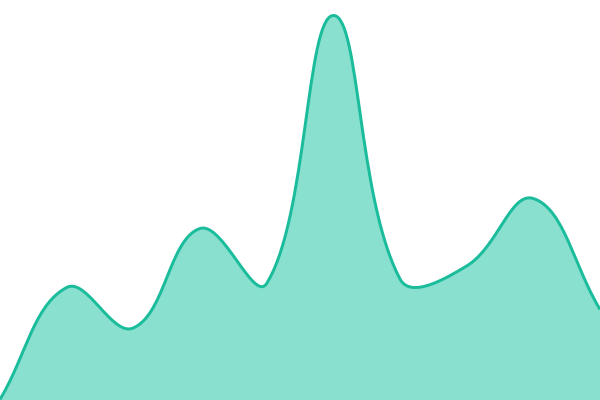
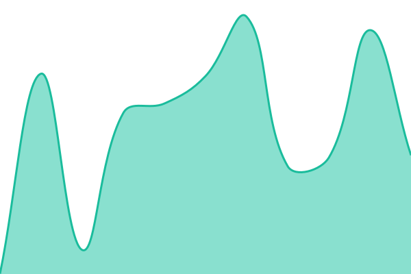
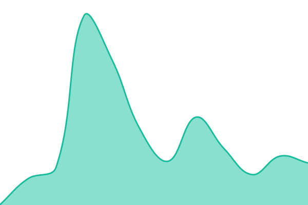
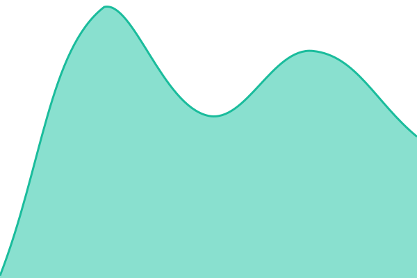
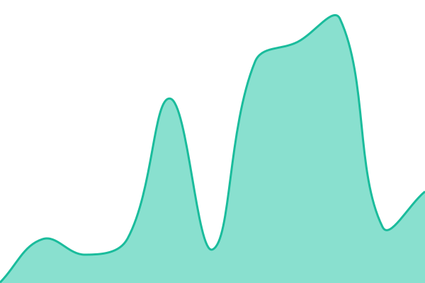

# [📈 Live Status](https://status.relaxingame.app): <!--live status--> **🟧 Partial outage**

This repository contains the open-source uptime monitor and status page for [Inaki-de-miguel](https://status.relaxingame.app), powered by [Upptime](https://github.com/upptime/upptime).

With [Upptime](https://upptime.js.org), you can get your own unlimited and free uptime monitor and status page, powered entirely by a GitHub repository. We use [Issues](https://github.com/Inaki-de-miguel/relaxingame-status/issues) as incident reports, [Actions](https://github.com/Inaki-de-miguel/relaxingame-status/actions) as uptime monitors, and [Pages](https://status.relaxingame.app) for the status page.

<!--start: status pages-->
<!-- This summary is generated by Upptime (https://github.com/upptime/upptime) -->
<!-- Do not edit this manually, your changes will be overwritten -->
<!-- prettier-ignore -->
| URL | Status | History | Response Time | Uptime |
| --- | ------ | ------- | ------------- | ------ |
|  [Web](https://relaxingame.app) | 🟩 Up | [web.yml](https://github.com/Inaki-de-miguel/relaxingame-status/commits/HEAD/history/web.yml) | 

 255ms
     
 | 

<a href="https://status.relaxingame.app/history/web">100.00%</a>
    

|  [Estadísticas](https://web-production-f2a7e.up.railway.app/health) | 🟩 Up | [estadisticas.yml](https://github.com/Inaki-de-miguel/relaxingame-status/commits/HEAD/history/estadisticas.yml) | 

 209ms
     
 | 

<a href="https://status.relaxingame.app/history/estadisticas">100.00%</a>
    

|  [Base de datos](https://web-production-f2a7e.up.railway.app/health/db?deep_check=true) | 🟩 Up | [base-de-datos.yml](https://github.com/Inaki-de-miguel/relaxingame-status/commits/HEAD/history/base-de-datos.yml) | 

 333ms
     
 | 

<a href="https://status.relaxingame.app/history/base-de-datos">100.00%</a>
    

|  [API de Riot](https://web-production-f2a7e.up.railway.app/health/riot) | 🟥 Down | [api-riot.yml](https://github.com/Inaki-de-miguel/relaxingame-status/commits/HEAD/history/api-riot.yml) | 

 114ms
     
 | 

<a href="https://status.relaxingame.app/history/api-riot">19.02%</a>
    

|  [Inicio de sesión](https://web-production-f2a7e.up.railway.app/health/auth) | 🟥 Down | [login.yml](https://github.com/Inaki-de-miguel/relaxingame-status/commits/HEAD/history/login.yml) | 

 117ms
     
 | 

<a href="https://status.relaxingame.app/history/login">25.73%</a>
    

|  [Sincronización de partidas](https://web-production-f2a7e.up.railway.app/health/sync) | 🟥 Down | [sync.yml](https://github.com/Inaki-de-miguel/relaxingame-status/commits/HEAD/history/sync.yml) | 

 93ms
     
 | 

<a href="https://status.relaxingame.app/history/sync">35.32%</a>
    

|  [AI Coach](https://web-production-f2a7e.up.railway.app/health/ai) | 🟥 Down | [ai-coach.yml](https://github.com/Inaki-de-miguel/relaxingame-status/commits/HEAD/history/ai-coach.yml) | 

 205ms
     
 | 

<a href="https://status.relaxingame.app/history/ai-coach">64.15%</a>
    

<!--end: status pages-->

[**Visit our status website →**](https://status.relaxingame.app)

## 📄 License

- Powered by: [Upptime](https://github.com/upptime/upptime)
- Code: [MIT](./LICENSE) © [Anand Chowdhary](https://anandchowdhary.com)
- Data in the `./history` directory: [Open Database License](https://opendatacommons.org/licenses/odbl/1-0/)
